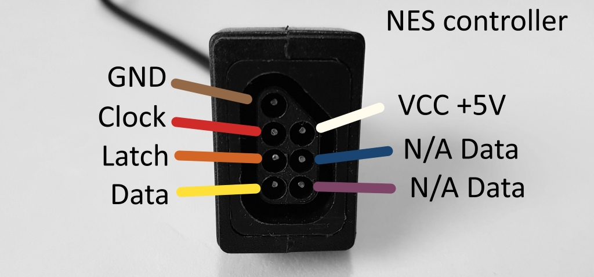

# nes-emulator

A NES emulator that runs on the Avnet ZedBoard (Zynq-7000, Cortex-A9) under
Zephyr RTOS. The emulated PPU draws into a BRAM framebuffer that a VGA
controller in the FPGA fabric scans out, and a real NES controller is read
over PMOD GPIO.

This is the software half of a bachelor thesis project. The FPGA half (VGA
controller, block design, bitstream) lives in the Vivado project repo
[NesBoard](https://github.com/stolniceanuiustin/NesBoard).

## How it works

```
        Cortex-A9 (Zephyr)                          Programmable logic
 ┌──────────────────────────────┐             ┌──────────────────────────┐
 │ emu thread   6502 + PPU      │  AXI        │ AXI BRAM ctrl + 64 KB    │
 │   1 frame -> 256x240 pixels ─┼────────────>│ BRAM @ 0x4000_0000       │──> VGA
 │ input thread  NES controller │             │ VGA controller           │
 │   (EMIO GPIO, polled 10 ms)  │<── JA PMOD ─┤ EMIO GPIO 0..2           │
 │ net: TCP framebuffer stream  │             └──────────────────────────┘
 └──────────────────────────────┘
```

- The emulation thread runs one NES frame per iteration (scanline-based PPU,
  about 113.67 CPU cycles per scanline) and is paced to 60 Hz with absolute
  deadlines.
- Each frame is `256x240` bytes of NES palette indices. It is copied to the
  BRAM framebuffer (mapped uncached at `0x40000000`) and also streamed over
  TCP for debugging.
- The PL310 L2 cache controller is enabled to reach 60 fps.
- The ROM is embedded into the firmware at build time.

Supported cartridges: NROM (mapper 0), MMC1 (1), MMC3 (4).

## Repository layout

```
app/                  Zephyr application
  CMakeLists.txt, prj.conf
  boards/zedboard.overlay     controller GPIO + BRAM framebuffer nodes
  include/                    headers
  src/main.cpp                threads, frame pacing, init
  src/cpu/                    6502 core, instructions, addressing
  src/ppu/                    PPU (background, sprites, scroll)
  src/bus/                    CPU bus, memory map, cartridge + mappers
  src/input/nes_controller.cpp  NES controller driver (74HC4021 protocol)
  src/video/                  framebuffer TCP sender, palette table
tests/controller/     standalone controller test, prints button state
tools/pc_viewer/      PC-side viewer for the TCP framebuffer stream
tools/zfpga/          submodule: flash a Zephyr app + bitstream to the SD card
west.yml              pins Zephyr (upstream main + PL310 support)
```

## Hardware

- Avnet ZedBoard
- NES controller (original or clone)
- Monitor on the ZedBoard VGA connector
- The bitstream built from the NesBoard Vivado project

### NES controller pinout



Source: [NESPi project part 4, the NES controller protocol](https://www.raspberryfield.life/2018/09/01/nespi-project-part-4-the-nes-controller-protocol/)
(raspberryfield.life). The photo shows the controller-side connector
looking into the socket; the table below is the same pinout numbered 1 to 7.

| NES pin | Signal | ZedBoard JA PMOD | EMIO / Zephyr |
|---------|--------|------------------|---------------|
| 1 | GND | GND | - |
| 2 | CLOCK | JA2 (AA11) | `psgpio_bank2` pin 1 |
| 3 | LATCH | JA1 (Y11) | `psgpio_bank2` pin 0 |
| 4 | DATA | JA3 (Y10) | `psgpio_bank2` pin 2 |
| 5 | N/C | - | - |
| 6 | N/C | - | - |
| 7 | VCC | JA VCC (3.3 V) | - |

The original console supplies +5 V. Here the controller is powered from the
PMOD's 3.3 V instead, so DATA stays within the Zynq LVCMOS33 input range; do
not connect it to 5 V. The pin assignments are in
`app/boards/zedboard.overlay` and in the Vivado XDC. Button bits are read
A, B, Select, Start, Up, Down, Left, Right.

## Build

Needs a Zephyr SDK and `west`. The workspace is created around this repo:

```
mkdir ws && cd ws
git clone --recurse-submodules https://github.com/stolniceanuiustin/NesBoard_Zephyr nes-emulator
west init -l nes-emulator
west update
west build -b zedboard nes-emulator/app -- -DNES_ROM=/path/to/game.nes
```

`-DNES_ROM` is required: the ROM is not part of the repo and is embedded in
the firmware as a C array. The build produces `build/zephyr/zephyr.bin`.

## Run

1. Build the bitstream in the NesBoard Vivado project (or use an existing
   `design_1_wrapper.bit`).
2. Put `zephyr.bin` and the bitstream on the ZedBoard SD card. U-Boot loads
   the bitstream first, then boots Zephyr, so the BRAM and GPIO exist before
   the app touches them. `tools/zfpga` automates this, see
   `tools/zfpga/README.md` for its workspace layout and SD card setup.
3. Connect the controller and VGA, power the board.

The serial console prints the profile once a second, for example
`avg/frame: emu=... us send=... us (capped ~60 fps)`.

### Optional: PC viewer

The board is a TCP server on `192.0.2.3:5555` and sends length-prefixed
frames of palette indices:

```
pip install pygame numpy
python3 tools/pc_viewer/viewer.py
```

Set a PC address in `192.0.2.0/24` on the interface cabled to the board.

### Controller test

```
west build -b zedboard nes-emulator/tests/controller
```

Prints the button state so you can check wiring before running the emulator.

## Known limitations

- The PPU is scanline-based, not cycle-accurate. Games that depend on
  mid-scanline timing (sprite-0 hit, MMC3 IRQ) may glitch.
- CPU cycle counts are a flat per-opcode table without page-cross or branch
  penalties, and unofficial opcodes are treated as NOPs.
- Only controller 1 is wired. No audio (APU).
- Mappers other than 0, 1 and 4 are rejected at load time.
