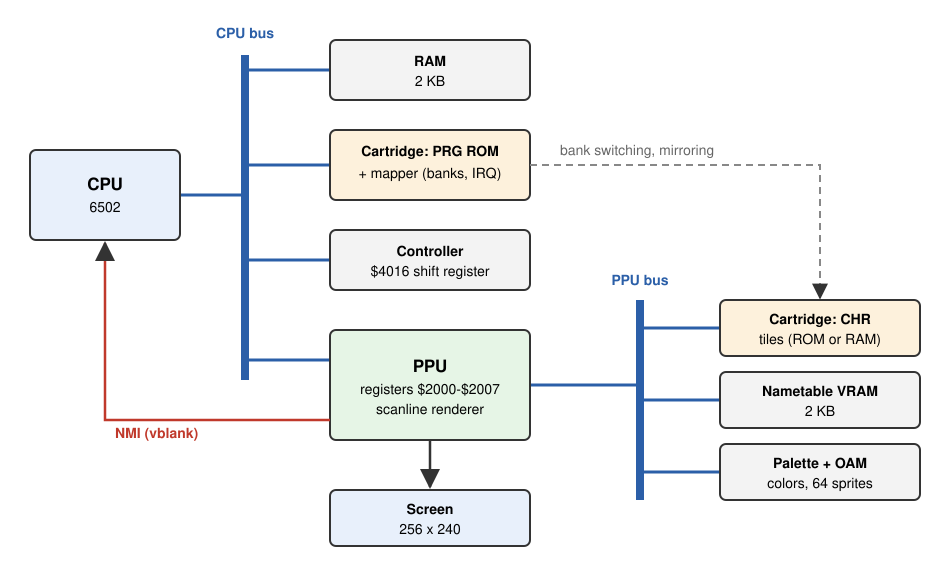

# NES emulator architecture

- Blue lines are the two buses. The CPU reaches RAM, the cartridge, the controller and the PPU registers through the CPU bus. The PPU reaches tiles, nametables and palette/sprite memory through its own bus.
- Red: the PPU raises NMI at vblank.
- Dashed: the cartridge mapper swaps banks and sets nametable mirroring.
